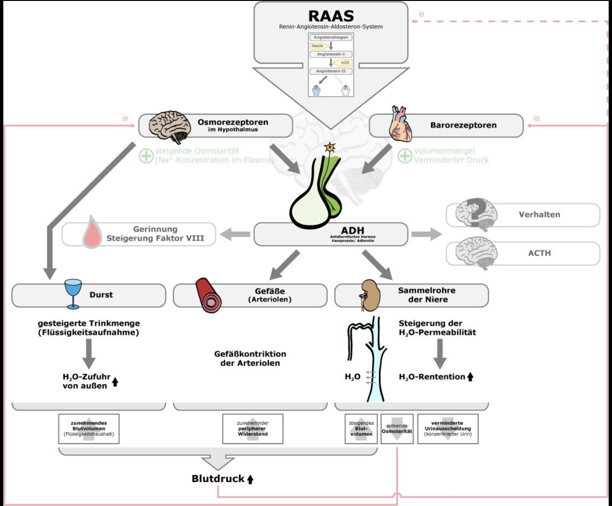

# ADH
= „Antidiuretisches Hormon“  
= Vasopressin 
≈ Argipressin („Empressin“) 
≠ [Desmopressin](Desmopressin.md) (das ist ein synthetisches Analogon 😉)
*(Stand: Juli 2026)*

---

> [!warning] verwirrende Namen
> - ADH wird auch Vasopressin oder Adiuretin genannt
> - Argipressin ist das Medikament, welches wie ADH wirkt
> - Desmopressin ist ein synthetisches Analogon, welches nur am V2-Rezeptor wirkt (Niere & Gerinnung)

---

{width="200"}

(Bild 1)

---

## 💬 KURZ
- ADH ist ein im Hypothalamus gebildetes und im Hypophysenhinterlappen gespeichertes Hormon  
- Es reguliert den Wasserhaushalt, den Gefäßtonus und beeinflusst die Hämostase  
- Das Medikament Argipressin („Empressin“) wird z.B. im Septischen Schock verwendet  
- Das synthetische Analogon **[Desmopressin](Desmopressin.md)** wirkt länger und selektiv über V2-Rezeptoren (Niere & Gerinnung)  

---

## 🚨 CAVE / MERKE 💡
- **ADH-Überschuss**  
	→ [Hyponatriaemie](Hyponatriaemie.md) (z. B. SIADH)  
- **ADH-Mangel**  
	→ Diabetes insipidus  
- [Desmopressin](Desmopressin.md) darf **nicht** bei Herzinsuffizienz oder [Hyponatriaemie](Hyponatriaemie.md) gegeben werden  

---

## 💊 DOSIERUNG (von Argipressin)

| **Indikation**              | **Zieldosis (IE/min)** | **Dosierung (ml/h)** | **Hinweise**                                                        |
| --------------------------- | ---------------------- | -------------------- | ------------------------------------------------------------------- |
| Septischer Schock           | 0,01 IE/min            | **0,75 ml/h**        | Startdosierung                                                      |
|                             | 0,02 IE/min            | **1,5 ml/h**         | Standarddosierung in den meisten Protokollen.                       |
|                             | 0,03 IE/min            | **2,25 ml/h**        | Standarddosierung in den meisten Protokollen.                       |
|                             | 0,04 IE/min            | **3,0 ml/h**         | Maximaldosis, nur bei refraktärem Schock.                           |
| Ösophagusvarizenblutung     | 0,2–0,4 IE/min         | **15–30 ml/h**       | Kurzzeitanwendung (20–40 min), kombiniert mit Nitroglycerin.        |
| Kardiopulmonale Reanimation | 0,04 IE/min (Bolus)    | **3,0 ml/h**         | Einmalige Gabe von 40 IE (50 ml), aber in der Praxis oft als Bolus. |
> [!INFO] Perfusor-Konzentration: Vasopressin
> **Standardmischung:**
> - **40 IE Vasopressin** in **50 ml NaCl 0,9%**
> - **Konzentration:** **0,8 IE/ml**
>
> **Hinweise:**
> - **Einstellung in ml/h** (nicht in IE/min).
> - **Umrechnung:**
>   `1 ml/h = 0,8 IE/h ≈ 0,013 IE/min`
> - **Praktische Dosierung:**
>   - **1 ml/h** ≈ **0,013 IE/min** (Startdosis)
>   - **3 ml/h** ≈ **0,04 IE/min** (Maximaldosis bei septischem Schock)

---

## ⚙️ PATHOPHYSIOLOGIE
- **Osmorezeptoren** im Hypothalamus messen Plasmaosmolalität  
- **Volumenrezeptoren** (Vorhöfe, Barorezeptoren) reagieren auf Blutvolumen/-druck  
- Bei ↑ Osmolalität oder ↓ Volumen  
	→ ADH-Ausschüttung  

---

## ✨ WIRKUNG
### 1. V1-Rezeptoren
- **Vasokonstriktion**  
	→ Blutdrucksteigerung  

### 2. V2-Rezeptoren
- Bindung an V2-Rezeptoren im Sammelrohr der Niere  
	→ Einbau von Aquaporin-2-Kanälen  
	→ **Wasserrückresorption** ↑  
	→ Blutvolumen ↑ (& konzentrierter Urin)  
	→ RR-Anstieg  

### 3. Hämostase
- **Freisetzungw von von-Willebrand-Faktor (vWF)**  
- Steigerung von Faktor VIII  
- Aktivierung thrombozytärer Adhäsionsmoleküle  
- Klinisch: Verbesserung der primären und sekundären Hämostase  

---

## 📌 KLINISCHE HINWEISE
- **Mangel**:  
	→ Diabetes insipidus (Polyurie, Polydipsie)  
- **Überschuss**:  
	→ SIADH → [Hyponatriaemie](Hyponatriaemie.md), neurologische Symptome  

---

## 🔎 NORMWERTE
- **Plasmaosmolalität**: ca. 280–300 mosmol/kg  
- **Natrium**: 135–145 mmol/l  
- **Urinosmolalität**: variabel, abhängig von ADH-Wirkung  

---

## ⚗️ CHEMIE
- Peptidhormon (Nonapeptid)  
- Synthese: Nucleus supraopticus & paraventricularis (Hypothalamus)  
- Speicherung & Freisetzung: Neurohypophyse  

---

  
🔤 Abkürzungen

  <table>
    <thead>
      <tr>
        <th>Abkürzung</th>
        <th>Bedeutung</th>
      </tr>
    </thead>
    <tbody>
      <tr><td>ADH</td><td>Antidiuretisches Hormon</td></tr>
      <tr><td>SIADH</td><td>Syndrom der inadäquaten ADH-Sekretion</td></tr>
      <tr><td>vWF</td><td>von-Willebrand-Faktor</td></tr>
    </tbody>
  </table>

  
📚 Quellen

  <ul>
    <li>Robertson GL. Antidiuretic hormone. <i>N Engl J Med</i>. 1984;310(9):562–573.</li>
    <li>Verbalis JG. Disorders of water balance. In: Jameson JL, Fauci AS, Kasper DL, et al. <i>Harrison’s Principles of Internal Medicine</i>. 21st ed. McGraw-Hill; 2022.</li>
    <li>Schrier RW. Vasopressin and aquaporin 2 in clinical disorders of water homeostasis. <i>Semin Nephrol</i>. 2008;28(3):289–296.</li>
    <li>Mannucci PM. Desmopressin (DDAVP) in the treatment of bleeding disorders: the first 20 years. <i>Blood</i>. 1997;90(7):2515–2521.</li>
    <li>Schwarz C, Lindner G, Windpessl M, Knechtelsdorfer M, Saemann MD. Konsensusempfehlungen zur Diagnose und Therapie der Hyponatriämie der Österreichischen Gesellschaft für Nephrologie 2024. <i>Wien Klin Wochenschr</i>. 2024;136(13–14):557–574. <a href="https://pmc.ncbi.nlm.nih.gov/articles/PMC10904443/">Link</a></li>
  </ul>

  
🏷️ Tags

  
#ADH #Vasopressin #Desmopressin #DiabetesInsipidus #SIADH #Endokrinologie #Nephrologie #Gerinnung

