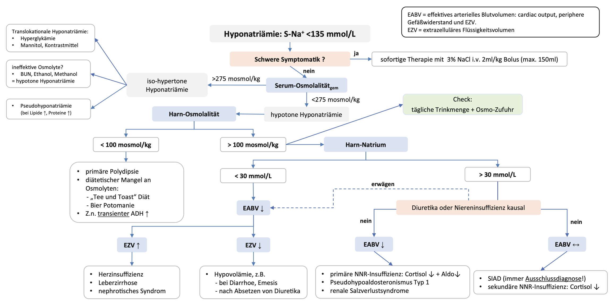

# Hyponatriämie

---
## 💬 KURZ

- **Hyponatriämie** = Serum-Na **<135** mmol/l
- Erstens Einteilung nach **Serum‑Osmolalität**:  
	→ **hypoton** (bei weitem **am häufigsten**), isoton, hyperton
 - Zweitens Einteilung nach dem **Volumenstatus**:  
	→ **hypovoläm** (stationär **am häufigsten**), euvoläm, hypervoläm
- Therapie:  
	→ bei akuten Symptomem 150 ml NaCl 3%  
	→ **hypovolämisch (am häufigsten) → VEL**  
	→ euvolämisch → Flüssigkeitsrestriktion  
	→ hypervolämisch → Diuretika  
	→ Polydipsie → Restriktion + Na-/Eiweißgabe  

---
## 🚨 CAVE / MERKE 💡
- **Gefährlich sind akute (<48 h) und symptomatische Formen**  
	→ Gefahr von Hirnödem und Krampfanfällen  
- **bei akuten Symptomen 150 ml NaCl 3%:**  
	→ ggf. wiederholen; Ziel: rasch +4–6 mmol/l  
- **bei chronischer Hyponatriämie:**  
	→ langsamer Ausgleich  
	→ engmaschige Kontrollen  
	→ ggf. [Desmopressin‑Clamp](obsidian://open?vault=Lexikon&file=Desmopressin-Clamp)  
- **Überkorrektur vermeiden:**  
	→ max. +8–10 mmol/l/24 h  
	→ bei Risikopatienten ≤6 mmol/l/24 h  
	→ sonst Risiko der osmotischen Demyelinisierung bei zu schneller Korrektur  

---
## 🔎 NORMWERTE
- **normal:** 135–145 mmol/l  
	<135 = leichte Hyponatriämie  
	<130 = moderate Hyponatriämie  
	<125 = schwere Hyponatriämie  
	<120 oder >160 mmol/l → **ITS**  
- **Serum-Osmolalität:**  
	→ 280–300 mOsm/kg  
- **Na-Zufuhr (Erhaltungsbedarf):**  
	→ ca. 2 g/Tag  
	→ entspricht ca. 700 ml VEL oder 1,5 l Sondennahrung  

---
## 📊 NATRIUMGEHALT

| Präparat / Substanz         | Einheit             | Na⁺-Gehalt (mmol) |
| --------------------------- | ------------------- | ----------------- |
| **NaCl 0,9 %**              | 1000 ml             | 154               |
| **NaCl 3 %**                | 100 ml              | 51,3              |
|                             | 150 ml              | 77                |
| **Jonosteril (VEL)**        | 1.000 ml            | 137               |
| **NaBic 8,4 %**             | 100 ml              | 100               |
| **NaCl-Tablette**           | 1 g                 | 17                |
|                             | 2 g                 | 34                |
| **Fosfomycin**              | 1 Durchstechflasche | 28,4              |
| **Moxifloxacin**            | 400 mg              | 13,5              |
| **Ciprofloxacin**           | 400 mg              | 12,0              |
| **Levofloxacin**            | 500 mg              | 6,1               |
| **Fluconazol**              | 200 mg              | 6,1               |
| **Humanalbumin 20%**        | 100 ml              | 5,7               |
| **Ampicillin/Sulbactam**    | 2/1 g               | 4,0               |
| **Piperacillin/Tazobactam** | 4/0,5 g             | 3,7               |
| **Ceftriaxon**              | 2 g                 | 2,9               |
| **Linezolid**               | 600 mg              | 2,0               |
| **Flucloxacillin**          | 2 g                 | 1,7               |
| **Meropenem**               | 1 g                 | 1,6               |
| **Cefuroxim**               | 1,5 g               | 1,4               |
| **Valproat**                | 400 mg              | 0,9               |
| **Cotrimoxazol**            | 480 mg              | 0,6               |
| **Levetiracetam**           | 500 mg              | 0,3               |

*(Berechnung: 1 g NaCl = 17,1 mmol Na⁺; Angaben gerundet, Quellen: Fachinformationen, Herstellerangaben)*

---
## 🧩 EINTEILUNG
#### 1. Schritt: Serum-Osmolalität bestimmen
 - **Hypoton** (<280 mOsm/kg):  
	 → *echte Hyponatriämie* (**häufigste** Form)  
 - Isoton (280–300 mOsm/kg):  
	 → *[Pseudohyponatriaemie](Pseudohyponatriaemie.md)* → falsch-niedriges Na im Labor → BGA machen  
 - Hyperton (>300 mOsm/kg):  
	 → *[Translokationale Hyponatriämie](Translokationale-Hyponatriaemie.md)*(z. B. Hyperglykämie, Mannitol)  
 - Synonyme:  
	 → hypoton = hyoosmolar  
	 → isoton = isoosmolar  
	 → hyperton = hyperosmolar  
#### 2. Schritt: Bei hypotoner Hyponatriämie → Volumenstatus
 - Hypovolämisch: Na‑Verlust > Wasserverlust
	 - *Renal*: Diuretika, NNR‑Insuffizienz, CSW
	 - *Extrarenal*: Erbrechen, Diarrhoe, Pankreatitis, Blutungen
 - Euvolämisch: Wasserüberschuss ohne Ödeme
	 - ⁠SIADH, Hypothyreose, sekundäre NNR‑Insuffizienz, Polydipsie
 - Hypervolämisch: Wasserüberschuss > Na‑Überschuss
	 - Herzinsuffizienz, Leberzirrhose, nephrotisches Syndrom, CNI
#### 3. Schritt: Sonderformen
 - Hyperosmotisch: Hyperglykämie → korrigiertes Na berechnen:
$$\text{Na}_{\text{corr}} = \text{Na}_{\text{gemessen}} + 1{,}6 \times \frac{\text{Glukose} - 100}{100}$$

---
## 🚑 KLINIK
 - **Asymptomatisch**: viele Patienten, v. a. bei chronischer Hyponatriämie
 - **Leicht**: Übelkeit, Kopfschmerz, Konzentrationsstörung
 - **Mittel**: Verwirrtheit, Schwindel, Gangunsicherheit
 - **Schwer**: Krampfanfälle, Koma, respiratorische Insuffizienz
 - **Chronisch**: oft oligosymptomatisch, aber erhöhtes Sturz‑ und Frakturrisiko

---
## 🩺 DIAGNOSTIK
#### 1. Flowchart
{ width="200"}

#### 2. weitere Laborparameter 🧪 
- Na zur Diagnose Hyponatriämie
- der ganze Rest (s. Tabelle) v.a. zum Ausschluss von DD

| Parameter                              | Differenzialdiagnosen / Ausschluss                                                                                                                |
| -------------------------------------- | ------------------------------------------------------------------------------------------------------------------------------------------------- |
| **Elektrolyte (Na, K, Cl, Ca, Mg)**    | 1. Hypokaliämie → verstärkt Risiko für Überkorrektur 2. Hyper-/Hypokalzämie als alternative Ursache für neurologische Symptome                 |
| **Osmolalität**                        | 1. [Pseudohyponatriaemie](Pseudohyponatriaemie.md) → isoton 2. [Translokationale Hyponatriämie](Translokationale-Hyponatriaemie.md) → hyperton |
| **BGA**                                | - Hypo-/Hyperosmolalität (Pseudo-/Hypertonie)  - Metabolische Azidose/Alkalose (z. B. NNR-Insuffizienz, Erbrechen, Diarrhö)                    |
| **Kreatinin**                          | AKI oder CNI → hypervolämische Hyponatriämie → Diuretika                                                                                          |
| **Harnstoff**                          | - Erhöht bei prärenaler Azotämie (Hypovolämie)  - Erhöht bei CNI (Hypervolämie)                                                                |
| **Glukose**                            | Hyperglykämie → hypertone Hyponatriämie (z. B. diabetisches Koma)                                                                                 |
| **TSH**                                | Hypothyreose → seltene DD der euvolämen Hyponatriämie                                                                                             |
| **Lipide, Proteine**                   | [Pseudohyponatriaemie](Pseudohyponatriaemie.md) → Lipide/Proteine ↑                                                                               |
| **Kortisol (morgens, ggf. ACTH-Test)** | NNR-Insuffizienz (Cortisol-/Aldosteronmangel) → hypovolämische Hyponatriämie                                                                      |

#### 3. Volumenstatus
 - Ödeme
 - Hautturgor
 - RR
 - Halsvenen

#### 4. Urin
- **Urin-Osmolalität:**:
	- Osmolalität <100 → Polydipsie/„Biertrinkerblase“
	- Osmolalität >100 → **Urin-Na** zur Differenzierung
- **Urin-Natrium**:
	- Natrium <30 mmol/l → *extrarenale* Ursache
	- Natrium >30 mmol/l → *renale* Ursache oder *SIADH*

#### 5. Bildgebung
 - **Thorax‑Röntgen/CT**: Pneumonie, Tumor (SIADH)
 - **Herzecho**: Herzinsuffizienz
 - **Abdomen‑Sono**: Leberzirrhose, Ascites, nephrotisches Syndrom.
 - **Neuro‑Bildgebung**: Verdacht auf CSW, intrakranielle Pathologie

---
## ⚙️ PATHOPHYSIOLOGIE
- **Hypovolämisch:** Na-Verlust > Wasserverlust → [ADH](ADH.md) ↑ → Wasserretention
- **Euvolämisch (SIADH):** inadäquate [ADH](ADH.md)-Sekretion → Wasserretention trotz normalem Volumen
- **Hypervolämisch:** Herzinsuffizienz, Zirrhose, Nephrose → effektives Volumen ↓ → [ADH](ADH.md) ↑
- **Polydipsie/„low-Natrium“:** zu viel Wasser und zu wenig Elektrolyte/Nahrung → Niere kann Wasser nicht ausscheiden

---
## 🏥 THERAPIE
#### 1. Notfalltherapie
- **nur bei akuten Symptomen:**  
	→ 150 ml NaCl 3%  
	→ ggf. wiederholen  
	→ Ziel: rasch +4–6 mmol/l  

#### 2. Generelle Therapie
- **Hypovolämisch:**  
	→ VEL, 50-150 ml/h (Kein NaCl 0,9%!)  
	→ Diuretika absetzen  
	→ ggf. Steroidgabe  
	→ Na alle 2-4 h kontrollieren  
- **Euvolämisch (SIADH):**  
	→ Flüssigkeitsrestriktion  
	→ Ursache behandeln  
	→ ggf. [Vaptane](Vaptane.md)  
- **Hypervolämisch:**  
	→ Diuretika  
	→ Grunderkrankung behandeln  
- **Polydipsie/„low-Natrium“:**  
	→ Flüssigkeitsrestriktion  
	→ Na-/Eiweißgabe  
	→ 3 % NaCl nur bei Krampf/Koma  

#### 3. Überkorrektur
 - [Desmopressin‑Clamp](obsidian://open?vault=Lexikon&file=Desmopressin-Clamp)
 - Glukose 5%
---

  
🔤 Abkürzungen

  <table>
    <thead>
      <tr>
        <th>Abkürzung</th>
        <th>Bedeutung</th>
      </tr>
    </thead>
    <tbody>
      <tr><td><a href="ADH.html">ADH</a></td><td>Antidiuretisches Hormon</td></tr>
      <tr><td>ART</td><td>Arterielle Druckkurve</td></tr>
      <tr><td>BGA</td><td>Blutgasanalyse</td></tr>
      <tr><td>BZ</td><td>Blutzucker</td></tr>
      <tr><td>CNI</td><td>Chronische Niereninsuffizienz</td></tr>
      <tr><td>EZV</td><td>Extrazellularvolumen</td></tr>
      <tr><td>ITS</td><td>Intensivstation</td></tr>
      <tr><td>NaBic</td><td>Natriumbicarbonat</td></tr>
      <tr><td>NNR</td><td>Nebennierenrinde</td></tr>
      <tr><td>RAAS</td><td>Renin-Angiotensin-Aldosteron-System</td></tr>
      <tr><td>SIADH</td><td>Syndrom der inadäquaten ADH-Sekretion</td></tr>
      <tr><td>VEL</td><td>Vollelektrolytlösung</td></tr>
    </tbody>
  </table>

  
📚 Quellen

  <ul>
    <li>Spasovski G, et al. <em>Clinical practice guideline on diagnosis and treatment of hyponatraemia.</em> Eur J Endocrinol. 2014;170(3):G1–G47.</li>
    <li>Verbalis JG, et al. <em>Diagnosis, evaluation, and treatment of hyponatremia: expert panel recommendations.</em> Am J Med. 2013;126(10 Suppl 1):S1–42.</li>
    <li>Hoorn EJ, Zietse R. <em>Diagnosis and treatment of hyponatremia: compilation of the guidelines.</em> J Am Soc Nephrol. 2017;28(5):1340–1349.</li>
    <li>Rondon-Berrios H, Berl T. <em>Hyponatremia: pathophysiology, classification, manifestations and management.</em> Kidney Int. 2015;87(1):45–57.</li>
    <li>Sterns RH. <em>Treatment of severe hyponatremia.</em> Clin J Am Soc Nephrol. 2018;13(4):641–649.</li>
    <li>Orlemann T. <em>Diagnostik und Therapie der Hyponatriämie.</em> Notfall + Rettungsmedizin. 2021;24:123–134.</li>
    <li><a href="https://pmc.ncbi.nlm.nih.gov/articles/PMC10904443/" target="_blank">PMC10904443 – Comprehensive review on hyponatremia</a></li>
    <li>Schwarz C, Lindner G, Windpessl M, Knechtelsdorfer M, Saemann MD. Konsensusempfehlungen zur Diagnose und Therapie der Hyponatriämie der Österreichischen Gesellschaft für Nephrologie 2024. <em>Wien Klin Wochenschr</em>. 2024;136(13–14):557–574. <a href="https://pmc.ncbi.nlm.nih.gov/articles/PMC10904443/" target="_blank">Link</a></li>
    <li>von Kieseritzky K. <em>Warnzeichen bei Hyponatriämie nicht übersehen.</em> DIVI 2025 – Kongressbericht. Springer Medizin. 15.12.2025. Verfügbar unter: https://www.springermedizin.de/divi-2025/hyponatriaemie/warnzeichen-bei-hyponatriaemie-nicht-uebersehen/51817434 (Zugriff am 15.02.2026).</li>
  </ul>

  
🏷️ Tags

  
#Elektrolytentgleisung #Natrium #Hyponatriämie #Diuretika #ITS #Intensivmedizin #Endokrinologie #Notfallmedizin #Nephrologie #SIADH #Polydipsie #PontineMyelinolyse #Vaptane

